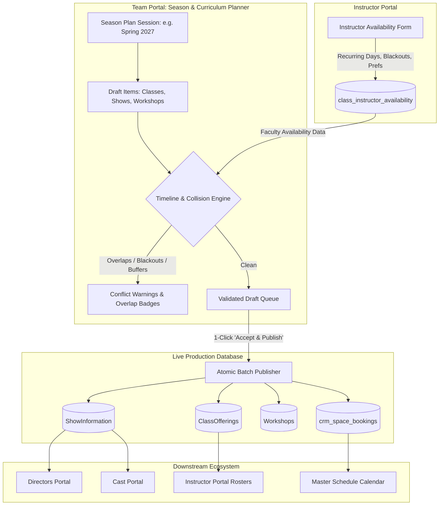

# Season & Curriculum Planner Architecture & Implementation Plan
**Cross-Portal Module: Team Management Portal + Instructor Portal**  
*Document Version: 1.0 — Date: October 2026*

---

## 1. Executive Summary & Objective

The **Season & Curriculum Planner** provides a draft staging sandbox in the **Team Management Portal** to plan, draft, and sanity-check upcoming programming across **Conservatory Classes**, **Public & Private Shows**, **Workshops**, and **Venue Rentals** before committing to live production tables.

### Key Value Propositions
1. **Zero Production Risk (Staging Sandbox)**: Staff can experiment with schedules, room allocations, and timelines without prematurely polluting production rosters, ticketing APIs, or public calendars.
2. **Automated Collision & Buffer Detection**: Detects room conflicts, director/instructor overbooking, stage turnaround buffers (30–60 min), and commercial rental buyouts.
3. **Instructor Availability Integration**: Connects with the **Instructor Portal** so faculty can declare recurring day availability, blackout dates, and accept/decline provisional class offerings.
4. **1-Click Batch Atomic Publishing**: Converts validated drafts into live `ShowInformation`, `ClassOfferings`, `Workshops`, and `crm_space_bookings` records in an atomic transaction with a batch rollback option.

---

## 2. Architecture & Data Flow



---

## 3. Database Schema Specifications

### 3.1 Planning Sessions (`planning_seasons`)
Defines the high-level umbrella (e.g., "Spring 2027 Term & Mainstage").

```sql
CREATE TABLE IF NOT EXISTS public.planning_seasons (
  season_id uuid PRIMARY KEY DEFAULT gen_random_uuid(),
  season_name text NOT NULL,                    -- e.g. 'Spring 2027 Mainstage & Conservatory'
  start_date date NOT NULL,
  end_date date NOT NULL,
  status text NOT NULL DEFAULT 'draft' CHECK (status IN ('draft', 'review', 'published', 'archived')),
  notes text NULL,
  created_at timestamptz NOT NULL DEFAULT now(),
  updated_at timestamptz NOT NULL DEFAULT now(),
  published_at timestamptz NULL,
  published_by uuid NULL REFERENCES auth.users(id)
);
```

### 3.2 Draft Items Ledger (`planning_items`)
Holds provisional shows, classes, and workshops before they are accepted.

```sql
CREATE TABLE IF NOT EXISTS public.planning_items (
  item_id uuid PRIMARY KEY DEFAULT gen_random_uuid(),
  season_id uuid NOT NULL REFERENCES public.planning_seasons(season_id) ON DELETE CASCADE,
  item_type text NOT NULL CHECK (item_type IN ('class', 'show', 'workshop')),
  
  -- Title & Presentation
  title text NOT NULL,
  subtitle_or_level text NULL,                   -- Level 1, English/Spanish, Show Type Name
  description text NULL,

  -- Venue / Space
  room_id integer NULL REFERENCES public.Rooms(RoomID),
  venue_name text NULL,

  -- Timing
  start_time time NOT NULL,
  end_time time NOT NULL,
  start_date date NOT NULL,
  end_date date NULL,                            -- NULL for single-date show/workshop, end date for 8-week class
  day_of_week text NULL,                         -- 'Monday', 'Tuesday', etc. for recurring classes
  total_sessions integer DEFAULT 1,              -- e.g. 8 for conservatory class, 1 for show
  skip_dates date[] NULL,                        -- Holiday / dark week dates skipped

  -- Personnel Leads
  primary_personnel_id integer NULL REFERENCES public.Personnel(PersonnelID),   -- Lead Instructor or Director
  secondary_personnel_id integer NULL REFERENCES public.Personnel(PersonnelID), -- TA or Assistant Director
  special_guest_id integer NULL REFERENCES public.SpecialGuests(GuestID),

  -- Operational / Financial Meta
  capacity integer DEFAULT 16,
  ticket_or_tuition_rate numeric DEFAULT 0,
  is_public_ticketed boolean DEFAULT true,

  -- Status & Conflict State
  validation_status text NOT NULL DEFAULT 'clean' CHECK (validation_status IN ('clean', 'conflict', 'warning')),
  conflict_details jsonb NULL,                   -- e.g. {"room_collision": true, "details": "Collides with Mainstage Show on May 4"}

  -- Published Record Links (Populated upon publication for traceability & rollback)
  published_show_id integer NULL REFERENCES public.ShowInformation(ShowID) ON DELETE SET NULL,
  published_offering_id integer NULL REFERENCES public.ClassOfferings(OfferingID) ON DELETE SET NULL,
  published_workshop_id integer NULL REFERENCES public.Workshops(WorkshopID) ON DELETE SET NULL,

  created_at timestamptz NOT NULL DEFAULT now(),
  updated_at timestamptz NOT NULL DEFAULT now()
);

CREATE INDEX IF NOT EXISTS idx_planning_items_season ON public.planning_items(season_id);
CREATE INDEX IF NOT EXISTS idx_planning_items_dates ON public.planning_items(start_date, end_date);
```

### 3.3 Instructor Availability Ledger (`class_instructor_availability`)
Allows faculty to submit recurring availability, preferences, and blackout dates.

```sql
CREATE TABLE IF NOT EXISTS public.class_instructor_availability (
  availability_id uuid PRIMARY KEY DEFAULT gen_random_uuid(),
  season_id uuid NULL REFERENCES public.planning_seasons(season_id) ON DELETE CASCADE,
  personnel_id integer NOT NULL REFERENCES public.Personnel(PersonnelID) ON DELETE CASCADE,
  day_of_week text NOT NULL CHECK (day_of_week IN ('Monday', 'Tuesday', 'Wednesday', 'Thursday', 'Friday', 'Saturday', 'Sunday')),
  time_preference text NOT NULL DEFAULT 'evening' CHECK (time_preference IN ('morning', 'afternoon', 'evening', 'any')),
  availability_status text NOT NULL DEFAULT 'available' CHECK (availability_status IN ('available', 'preferred', 'sub_only', 'unavailable')),
  preferred_levels integer[] NULL,              -- e.g. [1, 2, 3]
  max_classes_per_week integer DEFAULT 2,
  blackout_dates date[] NULL,                   -- Dates they cannot teach within the term
  notes text NULL,
  created_at timestamptz NOT NULL DEFAULT now(),
  updated_at timestamptz NOT NULL DEFAULT now(),
  CONSTRAINT uq_instructor_season_day UNIQUE (personnel_id, season_id, day_of_week)
);

CREATE INDEX IF NOT EXISTS idx_instructor_avail_personnel ON public.class_instructor_availability(personnel_id);
```

---

## 4. Conflict & Timeline Engine Specification

The collision detection engine checks every draft item against both **live production bookings** and **other items in the active draft plan**.

### Rules Evaluated:
1. **Physical Room Collision**:
   - `RoomID` overlap during the same time interval on any active date.
   - Cross-checks live `crm_space_bookings`, `ShowInformation`, `ClassOfferings`, and `venue_rentals`.
2. **Turnaround & Strike Buffer**:
   - Less than 30 minutes between an event ending and another starting in the same room triggers a `warning` ("Tight turnaround: Only 15m strike window").
3. **Personnel Double-Booking**:
   - An instructor or director assigned to two overlapping events simultaneously.
4. **Instructor Availability / Blackout Check**:
   - If an instructor is assigned to a class series on a day they marked `unavailable` or on a date included in their `blackout_dates` array.
5. **Dark Week Holiday Alignment**:
   - Automatically detects and flags sessions falling on major holidays (Thanksgiving, Christmas/New Year's, Memorial Day).

---

## 5. Phased Implementation Roadmap

### Phase 1: Database Foundation & Service Layer (Now)
- Create SQL migration for `planning_seasons`, `planning_items`, and `class_instructor_availability`.
- Add RLS policies and indexes.
- Build `plannerService.ts` with CRUD operations for seasons and draft items.
- Build draft publishing function with rollback capability.

### Phase 2: Instructor Portal Availability UI
- Add an "Availability & Preferences" tab to the Instructor Portal under `pages/Account.tsx` or a dedicated `pages/Availability.tsx`.
- Enable instructors to check days of week they can teach, select preferred class levels, set blackout dates, and leave scheduling notes.

### Phase 3: Team Portal Planning Workspace UI
- Create `pages/SeasonPlanner.tsx` in the Team Management Portal.
- Build Draft Item Add/Edit forms (Class, Show, Workshop).
- Add live conflict detection alerts and summary metrics banner.
- Add "1-Click Accept & Publish" modal with transaction preview.

### Phase 4: Navigation, Calendar Sync & Help Documentation
- Add Season Planner to the sidebar navigation and Help Guide in the Team Portal.
- Test end-to-end publishing into `ShowInformation`, `ClassOfferings`, and `Workshops`.
- Verify sync to downstream portals (Director, Cast, Instructor).

---

## 6. Verification & Acceptance Criteria
- [ ] Instructors can save availability and blackout dates from their portal.
- [ ] Team admins can create a planning session (e.g., "Fall 2026") and draft multi-week classes, shows, and workshops.
- [ ] Overlapping room bookings and instructor blackouts trigger visual warnings.
- [ ] Clicking "Accept & Publish" commits all items to live tables and links them to the master calendar.
- [ ] Rollback option cleanly archives/deletes published items if a season plan needs retraction.
